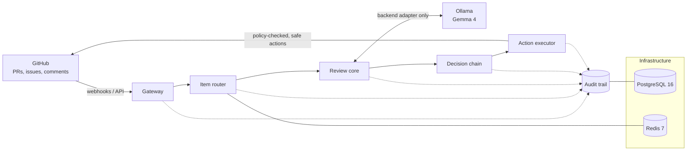
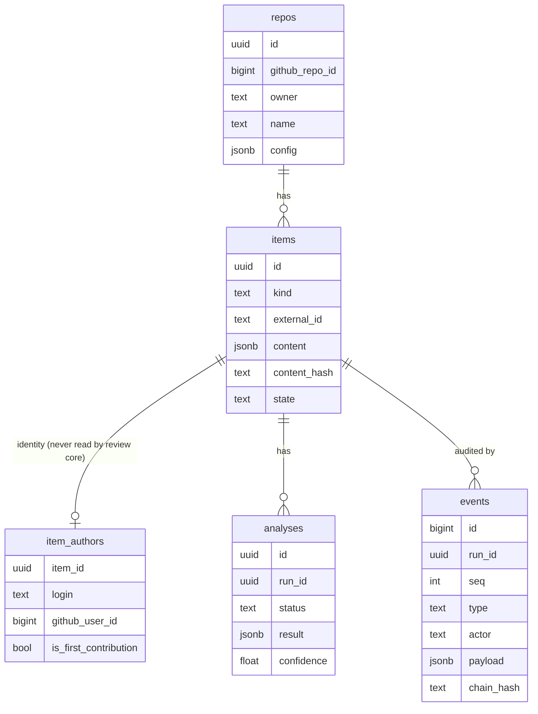
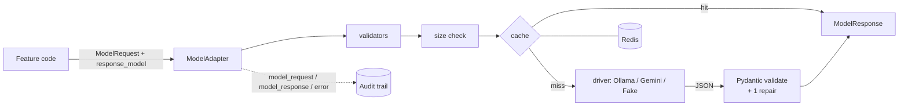
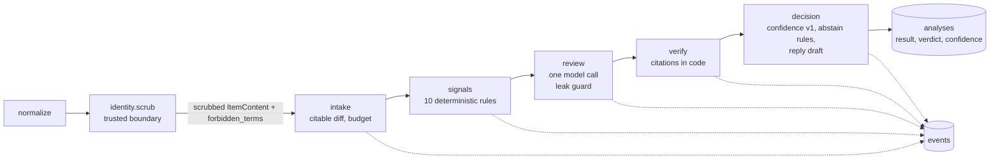

# Architecture

Status: **partly built**. As of P04 these exist: the gateway, the Postgres queue, the review core (identity scrub, signals, one model call, verifier, confidence, reply draft), the audit trail and the model adapter. The action executor is still planned, and nothing is posted to GitHub. The guiding decisions are in [ADR 0001](adr/0001-thesis-and-non-goals.md), [ADR 0002](adr/0002-database-identity-and-audit.md), [ADR 0003](adr/0003-model-adapter.md), [ADR 0004](adr/0004-intake-queue-and-identity-boundary.md), [ADR 0005](adr/0005-review-core.md) and [ADR 0006](adr/0006-hosted-gemma-and-key-pool.md).



## Layers

| Layer | Responsibility | Key constraints |
| --- | --- | --- |
| **Gateway** | Receives GitHub events (webhooks through a local relay, or API polling), verifies webhook signatures and normalizes payloads into internal items. | Rejects unsigned or invalid events. Treats all payload text as untrusted. |
| **Item router** | Classifies items (PR, issue, comment), dedupes redeliveries, and queues work via Redis. | Idempotent. Routing never depends on who the author is. |
| **Review core** | Gathers verifiable evidence (diff facts, CI results, linked issues, repo policy) and asks models focused questions. | **Contributor-blind**: identity fields are stripped before this layer. Every model call goes through the backend adapter, and its output is schema-validated. |
| **Decision chain** | Combines evidence into a typed decision with explicit confidence. "Uncertain" is a valid outcome. | Reputation may be shown as advisory context but never changes a score. |
| **Action executor** | Turns decisions into allowed actions (labels, comments, review requests) under a policy. | Dry-run by default. Auto-close is off by default and a first PR is never auto-closed. |
| **Audit trail** | An append-only event log of every pipeline step: inputs (by reference), model and prompt versions, outputs and actions. | Enough to replay any decision. Contains no secrets. |
| **Infrastructure** | Postgres (state and audit), Redis (queues and cache), Ollama (models), configuration and observability (OpenTelemetry). | Local only. Ports are bound to `127.0.0.1`. Secrets come from `.env`. |

## Cross-cutting rules

These are enforced in code and tests from the first feature prompt onward. The full list is in [CLAUDE.md](../CLAUDE.md).

- Untrusted text is data, never instructions.
- Typed schemas sit at every model boundary.
- Every step emits an audit event.
- No harmful automatic actions.

## Built in P01

| Module | What it provides |
| --- | --- |
| `gatekeeper.config` | Typed `Settings` for every `.env.example` key. Secrets are `SecretStr`. Components call `settings.require(...)` for what they need. |
| `gatekeeper.logging` | structlog over stdlib, JSON outside development, UTC timestamps, contextvars (`request_id`, `job_id`, `run_id`, `item_id`), and redaction before rendering. |
| `gatekeeper.errors` | `GatekeeperError` with stable codes. Only `to_public_dict()` may leave the process. |
| `gatekeeper.redaction` | The `Redactor` shared by logging and audit: secret values, GitHub tokens, bearer tokens, private keys and emails. |
| `gatekeeper.db` | SQLAlchemy 2.1 models and session helpers. Alembic revision `0001` lives in `backend/alembic`. |
| `gatekeeper.audit` | `AuditRecorder` / `Run` (append-only, hash-chained, fail-closed) and `AuditReader` (`get_events`, `verify_chain`). |

### Schema (revision 0001)



- **`items.content` is identity-free.** Identity lives only in `item_authors`, which the review core must never read.
- **`events` is append-only.** A trigger rejects UPDATE, DELETE and TRUNCATE. Each run's events form a SHA-256 chain over redacted payloads. Writing fails closed: if an event cannot be recorded, the step stops.

## Built in P02: model adapter and prompts



| Module | What it provides |
| --- | --- |
| `gatekeeper.models` | `get_backend()` returns the `ModelAdapter`. It provides typed requests and responses, retries with backoff, native structured output plus validation and one repair attempt, `InputTooLarge` instead of silent truncation, a fail-open Redis cache, and audit events written by the adapter. |
| `gatekeeper.models.testing` | `FakeBackend` and `fake_adapter()`. Every test uses these instead of a live model. |
| `gatekeeper.prompts` | Versioned `PromptTemplate`s. Untrusted slots are wrapped in escaped `<untrusted_content>` blocks, and the system text must state `UNTRUSTED_CONTENT_RULE`. |

## Built in P03: from event to audited analysis

```mermaid
flowchart LR
    GH[GitHub webhook] -->|HMAC verified, size-limited| GW[Gateway<br/>/webhooks/github]
    CLI[gatekeeper fetch-pr / enqueue-pr] --> Q
    GW -->|delivery row + job, one transaction| Q[(jobs<br/>Postgres queue)]
    Q -->|FOR UPDATE SKIP LOCKED, lease| W[Worker]
    W --> F[GitHub client<br/>read-only]
    F --> N[normalize]
    N -->|ItemContent| I[(items)]
    N -->|AuthorInfo| A[(item_authors)<br/>gatekeeper.identity only]
    W --> P[Pipeline: intake, signals, review, decision<br/>stubs, see ItemView only]
    P -.-> AT[(events)]
    P --> AN[(analyses)]
```

| Module | What it provides |
| --- | --- |
| `gatekeeper.github` | Read-only REST client (token or App auth, pagination, rate limits) and `normalize_pull`, the contributor-blind split. |
| `gatekeeper.api` | FastAPI gateway: signature-checked, idempotent webhook intake, `/healthz` and `/readyz`. |
| `gatekeeper.queue` | Postgres job queue with leases, heartbeats, retry, dead and dedupe, plus the worker loop. |
| `gatekeeper.pipeline` | `ItemView`, `PipelineContext`, `Step`, `Pipeline`, the stub steps and the `process_pr` job. |
| `gatekeeper.identity` | The only reader and writer of `item_authors`. |
| `gatekeeper.review_core` | Empty for now. An AST test forbids identity imports here and in the steps. |
| `gatekeeper.cli` | `gatekeeper fetch-pr`, `enqueue-pr`, `audit` and `jobs`. |

## Built in P04: the review core



| Module | What it provides |
| --- | --- |
| `gatekeeper.identity.scrub` | Removes the login, mentions, profile URLs and e-mails before storage. Produces `forbidden_terms` for the leak guard. |
| `gatekeeper.models.guards` | `forbidden_terms_guard`: blocks any model request that contains a forbidden term. |
| `gatekeeper.review_core.signals` | Deterministic, identity-free signals; thresholds live in `thresholds.py`. |
| `gatekeeper.review_core.diff` | Patch parsing, `L<n>|` rendering, importance-ordered token budget, `too_large`. |
| `gatekeeper.review_core.review` | Prompt `review.pr` v1, the `ReviewResult` schema and the single model call. |
| `gatekeeper.review_core.verifier` | Citation checks, `citation_validity`, the no-accusation-without-proof downgrade. |
| `gatekeeper.review_core.confidence` | Heuristic confidence v1 (uncalibrated) and the abstain decision. |
| `gatekeeper.review_core.reply` | Deterministic reply draft with the banned-word filter. |

## P05: hosted Gemma and the key pool

The default backend is `gemini_api` (Gemma 4 on the Gemini API), running through the same `ModelAdapter`. The Gemini driver takes keys from `KeyPool`:

- rotation (round robin or primary first);
- cooldowns on 429, with the request moving to the next key without using a retry;
- invalid keys dropped for the process;
- keys referred to only by alias.

`process_pr` refuses private repositories on a hosted backend unless explicitly allowed. Ollama stays available as the local backend.

## P06: side panel, activity feed, chat and the approved comment

See [ADR 0007](adr/0007-extension-first-ui.md).

| Piece | What it provides |
| --- | --- |
| `gatekeeper.activity` | A best-effort, redacted, identity-free display feed (`activity_events`). `file_states` replays it into per-file progress. The audit trail stays the source of truth. |
| `gatekeeper.api.extension` | The bearer-protected `/api`: context, PR view, analyse, activity and SSE stream, model input, repo tree, metrics, chat, and the approved comment. |
| `gatekeeper.chat` | Grounded, read-only chat (prompt `chat.pr` v1). Questions are scrubbed through `gatekeeper.identity`; references are checked against the diff. |
| `extension/` | The Chromium side panel (Activity, Chat, Insights), a background worker for tab routing, and a DOM-only content script for revealing diffs. |

The pipeline emits these activity events from real work only:

- `run_started`;
- `step_started` and `step_finished`;
- `files_listed`, `file_signal`, `file_context`, `signals_summary`;
- `model_call_started` and `model_call_finished`;
- `file_cited`, then `citation_verified` or `citation_dropped`;
- `confidence_computed`, `verdict`, `abstained`;
- `awaiting_approval`;
- `run_finished` or `run_failed`.

The panel reads them over SSE (fetch streaming, because EventSource cannot send an Authorization header) and plays them back about 120 ms apart.

GitHub writes: exactly one, `create_issue_comment`, behind `allow_write=True`. Only the approved-comment endpoint calls it.
