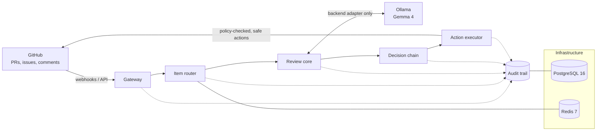
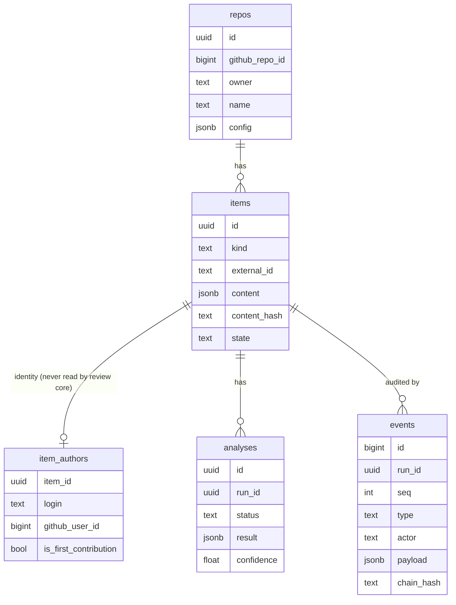
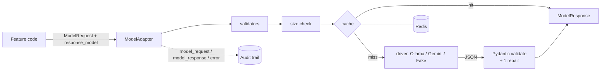

# Architecture

Status: **partly built**. As of P02 these exist: the infrastructure layer, the audit trail library, and the model adapter that the review core will use. The other layers are planned. The guiding decisions are in [ADR 0001](adr/0001-thesis-and-non-goals.md), [ADR 0002](adr/0002-database-identity-and-audit.md) and [ADR 0003](adr/0003-model-adapter.md).

## Layers

| Layer | Responsibility | Key constraints |
| --- | --- | --- |
| **Gateway** | Receives GitHub events (webhooks through a local relay, or API polling), verifies webhook signatures and normalizes payloads into internal items. | Rejects unsigned or invalid events. Treats all payload text as untrusted. |
| **Item router** | Classifies items (PR, issue, comment), dedupes redeliveries, and queues work via Redis. | Idempotent. Routing never depends on who the author is. |
| **Review core** | Gathers verifiable evidence (diff facts, CI results, linked issues, repo policy) and asks models focused questions. | **Contributor-blind**: identity fields are stripped before this layer. Every model call goes through the backend adapter, and its output is schema-validated. |
| **Decision chain** | Combines evidence into a typed decision with explicit confidence. "Uncertain" is a valid outcome. | Reputation may be shown as advisory context but never changes a score. |
| **Action executor** | Turns decisions into allowed actions (labels, comments, review requests) under a policy. | Dry-run by default. Auto-close is off by default and a first PR is never auto-closed. |
| **Audit trail** | An append-only event log of every pipeline step: inputs (by reference), model and prompt versions, outputs and actions. | Enough to replay any decision. Contains no secrets. |
| **Infrastructure** | Postgres (state and audit), Redis (queues and cache), Ollama (models), configuration and observability (OpenTelemetry). | Local only. Ports are bound to `127.0.0.1`. Secrets come from `.env`. |

## Cross-cutting rules

These are enforced in code and tests from the first feature prompt onward. The full list is in [CLAUDE.md](../CLAUDE.md).

- Untrusted text is data, never instructions.
- Typed schemas sit at every model boundary.
- Every step emits an audit event.
- No harmful automatic actions.

## Built in P01

| Module | What it provides |
| --- | --- |
| `gatekeeper.config` | Typed `Settings` for every `.env.example` key. Secrets are `SecretStr`. Components call `settings.require(...)` for what they need. |
| `gatekeeper.logging` | structlog over stdlib, JSON outside development, UTC timestamps, contextvars (`request_id`, `job_id`, `run_id`, `item_id`), and redaction before rendering. |
| `gatekeeper.errors` | `GatekeeperError` with stable codes. Only `to_public_dict()` may leave the process. |
| `gatekeeper.redaction` | The `Redactor` shared by logging and audit: secret values, GitHub tokens, bearer tokens, private keys and emails. |
| `gatekeeper.db` | SQLAlchemy 2.1 models and session helpers. Alembic revision `0001` lives in `backend/alembic`. |
| `gatekeeper.audit` | `AuditRecorder` / `Run` (append-only, hash-chained, fail-closed) and `AuditReader` (`get_events`, `verify_chain`). |

### Schema (revision 0001)

- **`items.content` is identity-free.** Identity lives only in `item_authors`, which the review core must never read.
- **`events` is append-only.** A trigger rejects UPDATE, DELETE and TRUNCATE. Each run's events form a SHA-256 chain over redacted payloads. Writing fails closed: if an event cannot be recorded, the step stops.

## Built in P02: model adapter and prompts

| Module | What it provides |
| --- | --- |
| `gatekeeper.models` | `get_backend()` returns the `ModelAdapter`. It provides typed requests and responses, retries with backoff, native structured output plus validation and one repair attempt, `InputTooLarge` instead of silent truncation, a fail-open Redis cache, and audit events written by the adapter. |
| `gatekeeper.models.testing` | `FakeBackend` and `fake_adapter()`. Every test uses these instead of a live model. |
| `gatekeeper.prompts` | Versioned `PromptTemplate`s. Untrusted slots are wrapped in escaped `<untrusted_content>` blocks, and the system text must state `UNTRUSTED_CONTENT_RULE`. |
