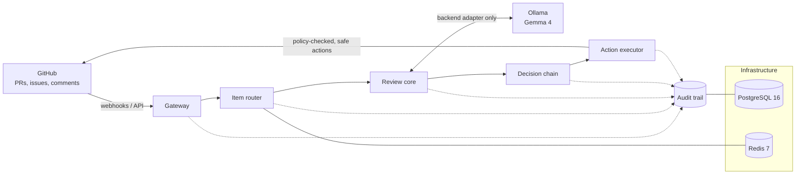

# Architecture

Status: **planned**. As of P00 only the infrastructure layer exists (Postgres, Redis and a local Ollama). Later prompts build the other layers and refine this page. The guiding decisions are in [ADR 0001](adr/0001-thesis-and-non-goals.md).

## Layers

| Layer | Responsibility | Key constraints |
| --- | --- | --- |
| **Gateway** | Receives GitHub events (webhooks through a local relay, or API polling), verifies webhook signatures and normalizes payloads into internal items. | Rejects unsigned or invalid events. Treats all payload text as untrusted. |
| **Item router** | Classifies items (PR, issue, comment), dedupes redeliveries, and queues work via Redis. | Idempotent. Routing never depends on who the author is. |
| **Review core** | Gathers verifiable evidence (diff facts, CI results, linked issues, repo policy) and asks models focused questions. | **Contributor-blind**: identity fields are stripped before this layer. Every model call goes through the backend adapter, and its output is schema-validated. |
| **Decision chain** | Combines evidence into a typed decision with explicit confidence. "Uncertain" is a valid outcome. | Reputation may be shown as advisory context but never changes a score. |
| **Action executor** | Turns decisions into allowed actions (labels, comments, review requests) under a policy. | Dry-run by default. Auto-close is off by default and a first PR is never auto-closed. |
| **Audit trail** | An append-only event log of every pipeline step: inputs (by reference), model and prompt versions, outputs and actions. | Enough to replay any decision. Contains no secrets. |
| **Infrastructure** | Postgres (state and audit), Redis (queues and cache), Ollama (models), configuration and observability (OpenTelemetry). | Local only. Ports are bound to `127.0.0.1`. Secrets come from `.env`. |

## Cross-cutting rules

These are enforced in code and tests from the first feature prompt onward. The full list is in [CLAUDE.md](../CLAUDE.md).

- Untrusted text is data, never instructions.
- Typed schemas sit at every model boundary.
- Every step emits an audit event.
- No harmful automatic actions.
